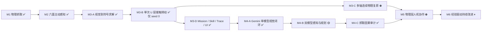

# CubeRelay：项目目标、当前能力与后续计划

> 状态日期：2026-11-16  
> 依据：当前仓库代码、测试、`results/` 验收产物及 `docs/` 阶段报告交叉核对。本文由原工作区外的 `cuberelay_status_and_plan.md` 更新并迁入项目，作为后续状态与计划的项目内入口。

## 1. 项目目标

CubeRelay 以“人机接力解魔方”为可验证实验载体，研究核心是 **Interactive Plan Repair**：机器人通过真实物理交互获取未知状态，自主感知、规划和执行；当人类改变环境后，系统能够发现计划偏离、重新理解状态、修复计划并继续协作。

目标 Demo：随机摆放并打乱魔方 → 相机定位和抓取 → 主动观察六面 → 生成并执行解法 → 交给人类干预 → 再观察、识别偏离、重新规划 → 人机协作完成复原。

项目包含两条相互依赖的主线：

| 主线 | 当前定位 |
| --- | --- |
| Agent 能力 | 已从规则规划推进到真实 Gemini 单模型视觉闭环，并完成 VLM 感知与 Agent 规划分离的双模型架构；跨场景在线证据仍不足 |
| 机器人基础设施 | 已具备 MuJoCo 抓取、六面扫描、单次 U 层接触转动、Mission/Skill/Trace/UI，并新增可导出的抓取因果审计链；抓取工作空间鲁棒性和多轴连续物理复原仍是主要瓶颈 |

## 2. 路线图与当前位置

| 里程碑 | 状态 | 已有证据 | 未完成边界 |
| --- | --- | --- | --- |
| M1 物理抓取 | ✅ | v6 Fixed-3 95%，Real-VLM-3 91% | VLM 未优于固定策略；不是真机结果 |
| M2 六面主动感知 | ✅ | Sequential 19/20，NBV 38/50，困难集 12/20 | 困难集与 NBV 稳定性仍弱；旧 EGL 扫描路径有 1 个持续失败 |
| M3-A 视觉到符号求解 | ✅ | 54 格状态可做合法性检查并由 Kociemba 求解，独立符号引擎验证 | 视觉完整扫描失败时不能进入求解 |
| M3-B 单次物理 U 转动 | ✅（限定场景） | seed=0，同一 `MjModel/MjData`，接触驱动 +90°，受影响 21/21 格验证 | 仅支持单次 `U`；不是 26 cubie 模型；转后 D 面 9 格未重扫 |
| M3-D 编排与可观测性 | ✅ | 3 类 Mission、SkillRegistry、安全门、层级 Trace、WebSocket 与 LIVE UI | `SOLVE_CUBE` 会诚实停在能力边界 |
| M4-A Gemini VLM 闭环 | ✅（有在线单例） | 真实 RGB、多轮 Skill 决策、反馈图像、视觉消融、无规则 fallback | 在线成功主要是 seed=0 `INSPECT_CUBE`；修复后的 VERIFY/SOLVE 尚未在线复验 |
| M4-B 双模型闭环 | 🟡 架构完成 | VLM 感知和 Agent 规划独立 Provider；Fake Provider + 真实 MuJoCo 物理闭环通过 | 尚无两个真实在线 Provider 的端到端验收；四组对照 runner 未完整实现 |
| M4-C 抓取因果审计 | ✅（审计闭环） | RGB-D → Pose → Grasp Target → Trajectory → Contact 全链引用；+5/+10 cm 扰动与视觉中断负对照；53 项 GL 定向回归通过 | 只有 seed=0 四条件；+5 cm 重抓失败，+10 cm 首抓过冲失败，证明审计能力强于执行鲁棒性 |
| M3-C / M5 / M6 | ⛔ / ⛔ / ⏸ | 符号层已有计划修复；物理边界能被安全拦截 | 多轴物理转面、人类物理干预、经验记忆尚未实现 |

## 3. 当前可用能力

### 3.1 符号、协作与基础实验

- 完整 3×3 魔方状态、18 种动作、合法性校验、Kociemba 求解和随机状态验证。
- 符号层 `TurnCoordinator` 支持人类非预期动作后的计划版本更新、重新求解、循环检测和确认门；这仍是软件层能力，不代表物理干预闭环。
- 可复现失败注入、轨迹记录、回放、基准评测与 90 秒 Demo。

### 3.2 具身感知与物理执行

- MuJoCo 场景包含 RGB-D 定位、随机位姿魔方、抓取、抬升、整体旋转、释放、重抓和多相机观察。
- v8 六面感知只使用相机像素和机器人本体感觉完成状态融合；顺序策略在 20 个场景中达到 19/20，困难集为 12/20。
- M3-B 将魔方简化为“U 层 + 下两层”两个刚体组，在固定工位由外部夹具通过真实接触驱动单次 `U` 转动。未直接设置层关节、未软件改色，并有移除接触后层不转的负对照。
- 当前物理能力清单只有 `physical_supported_moves=["U"]`。`U'`、`U2`、R/F/L/B/D 和连续序列均会被 Safety Gate 拒绝并记录 `CAPABILITY_BLOCKED`。

### 3.3 Mission、Skill、Trace 与 UI

- `INSPECT_CUBE`、`VERIFY_PHYSICAL_U_TURN`、`SOLVE_CUBE` 三类 Mission 共享 Mission/Plan/SkillRegistry/Session 架构。
- 细粒度主动感知 Skill 已暴露：定位、放置释放、观察可见面、重抓、重定向、结束观察、状态验证等；确定性复合扫描保留为基线。
- DecisionEvent 和层级 Skill Trace 关联 `observation_id`、`frame_id`、相机帧、Safety Gate、执行结果和模型延迟。
- LIVE 控制台显示真实 MuJoCo 渲染、Mission、Agent 决策、Skill 执行和历史图像；SAMPLE/LIVE/REPLAY 数据源隔离。模型启用密码只控制开关，API key 保持服务端。

### 3.4 M4-A：单模型 Gemini 视觉决策闭环

`GeminiMissionPlanner` 读取真实 MuJoCo RGB、任务状态和 Skill 白名单，输出结构化动作；动作经参数、前置条件、调用预算和物理能力校验后执行，新观测再进入下一轮决策。

`results/m4a_acceptance/` 中已有在线 `gemini-3.5-flash-lite`、seed=0、`INSPECT_CUBE` 证据：

| 指标 | 结果 |
| --- | ---: |
| Mission 状态 | `COMPLETED` |
| 六面覆盖 | 54/54，unknown=0，conflict=0 |
| 模型调用 | 10 次，均含真实图像 |
| 输入 / 输出 token | 22,643 / 1,176 |
| 模型累计延迟 | 23,797.41 ms |
| 仿真时间 / wall time | 29.942 s / 26.8283 s |
| 确定性 fallback | 无 |

真实图像、无图和替换图消融会改变模型动作，说明该受控案例存在视觉依赖；只有两次重复，不能据此声称跨场景稳定的主动视觉能力。Seed 0/1/2 对照中两种策略扫描成功率均为 100%，确定性策略 wall time 明显更短，因此当前 VLM 价值在于可审计、可替换的视觉决策链，而非性能优势。

### 3.5 M4-B：独立感知模型与规划模型

- `VLMPerceptionProvider`：只接收 RGB 与帧元数据，输出严格的 `SemanticSceneObservation`，不接收 Skill 列表。
- `AgentPlanningProvider`：只接收语义、CV 状态、Mission、历史、Skill 和能力边界，输出 `AgentActionDecision`，不接收图像字节。
- `DualModelDecisionClient`：强制“捕获图像 → 感知 → 规划 → 安全校验 → 执行 → 新图像”的因果顺序，并验证 observation/frame/evidence 引用。
- `LLMAgentDecisionPolicy`：复用 M4-A 已验证的动作映射和 Safety Gate，不直接访问 `MjData`。
- 真实 MuJoCo + 两个独立 Fake Provider 已完成物理闭环，证明接口分离和因果链可运行；这不是在线模型验收。

### 3.6 M4-C：抓取视觉因果链与实验导出

M4-C 将原先难以核验的抓取过程固化为可关联、可导出的证据链：原始 RGB-D 与相机标定 → `PoseEstimateRecord` → `GraspTargetRecord` → 50 Hz 轨迹和机器人状态 → 五阶段接触验证。运行时 `TruthAccessBoundary` 禁止感知/规划读取 MuJoCo 真值，审计真值单独标记并隔离保存。

四组真实 MuJoCo、seed=0 扰动实验的关键结论：

| 条件 | RGB-D 估计 ΔX | Grasp Target ΔX | Mission 结果 | 结论 |
| --- | ---: | ---: | --- | --- |
| baseline | 0 | 0 | `COMPLETED` | 基线抓取、重抓和扫描完成 |
| +5 cm | +0.050062 m | +0.050106 m | `FAILED` at `regrasp_cube` | 感知与目标正确响应；释放后邻近基座导致重抓几何失配，接触门正确阻断 |
| +10 cm | +0.099722 m | +0.099795 m | `FAILED` at `initial_grasp` | 感知与目标正确响应；固定时窗高速进近发生约 5.68 cm 横向误差并失去双侧接触 |
| +5 cm + 视觉中断 | 无 | 无 | `FAILED` (`INSUFFICIENT_MASK_PIXELS`) | 0 个抓取目标，证明系统未用真值或旧缓存继续执行 |

M4-C 同时修复了重抓成功后遥测未回写、历史 timeline 被当前阶段覆写、动作错误绑定旧 observation 等问题。实验包支持 SHA-256 manifest、外键完整性校验、脱敏和 SAMPLE 数据导出拒绝。最近定向验证记录为 53 个真实 MuJoCo GL/编排/API/Skill 测试通过，另有 4 个回放测试和 85 个核心非 GL 测试通过。

## 4. 证据等级与真实性边界

| 等级 | 可声称内容 | 当前代表性证据 |
| --- | --- | --- |
| 在线模型 + 真实 MuJoCo | 模型真实调用参与了闭环 | M4-A seed=0 `INSPECT_CUBE` 与视觉消融 |
| Fake Provider + 真实 MuJoCo | 协议、事件链、安全门和物理执行闭环可运行 | M4-A 定向回归、M4-B 双 Provider 测试 |
| 确定性 MuJoCo 验收 | 规则控制下的感知或物理能力 | v8 扫描、M3-B U 转动、M3-D 三 Mission |
| 真实 MuJoCo 因果扰动审计 | 传感器输入是否真实传导到执行，以及失败门是否诚实 | M4-C 四条件位置扰动与视觉中断负对照 |
| 符号 / Fake Backend | 状态机、协议和规划逻辑 | 协调器、API 与单元测试 |

必须保留以下限制：

1. 本地 Fake Backend 不能替代 MuJoCo，更不能替代在线模型实验。
2. M4-A 早期在线 `VERIFY_PHYSICAL_U_TURN` 与 `SOLVE_CUBE` 失败；虽然后续修复通过离线/服务器定向回归，但尚未在线复验。
3. M4-B 尚无真实双 Provider 在线结果，不能称为“在线双模型已通过”。
4. 全量服务器回归最近记录为 194 passed、1 failed；失败是旧 `active_scan()` 的 seed=1 EGL 路径，不能报告为全量通过。
5. 当前模型不是 26 cubie 接触互锁魔方，物理转层只有固定 seed=0 的单次正向 U 验收。
6. M4-C 证明位置估计和抓取目标会响应真实位移，但没有证明大工作空间内抓取成功；+5 cm 和 +10 cm 均暴露执行失败。
7. 没有双臂、真机驱动、硬件安全认证、物理人类干预或长期经验记忆。

## 5. 当前关键判断

1. **M4-A 已越过“VLM 未接入”的旧判断。** 现在的问题是证据覆盖不足，而不是接口缺失。
2. **M4-B 的架构价值已建立，但模型价值尚未建立。** 必须完成真实双 Provider 在线运行和 A/B/C/D 对照，才能比较 VLM 感知、LLM 规划及其组合各自贡献。
3. **M4-C 已证明“视觉决定抓取目标”，也定位了新的直接瓶颈。** +5/+10 cm 时感知正确而执行失败，说明下一步应优先修控制轨迹、释放工位与重抓可达性，而不是继续增加审计字段。
4. **最终 Demo 的结构性瓶颈仍是 M3-C。** 现有两刚体组无法执行多轴序列；但在扩展模型前，应先把位置扰动下的抓取/重抓成功域做稳，否则多轴任务会被上游执行不稳定掩盖。
5. **规则基线目前仍更快、更稳定。** 后续 Agent 实验应选择遮挡、异常恢复和人类介入等规则不容易覆盖的情形，而不是只重复固定扫描流程。
6. **Trace、Safety Gate 和因果导出已足够支撑研究实验。** 近期不应继续扩张 UI/审计层，应优先修执行鲁棒性、补在线证据并进入多轴物理能力。

## 6. 后续实施计划

### P0：冻结 M4-C 可复现基线（0.5 天）

- 将当前未提交的 M3-D、M4-A、M4-B、M4-C 代码、文档、前端和实验索引作为一个可追溯基线审查后提交。
- 在具备 GL/EGL 的 Python 3.11–3.13 环境重跑 M4-C 报告列出的 53 + 4 + 85 项分组测试，并单独记录旧扫描 seed=1 的历史失败状态。
- 固化四个 M4-C ZIP 包、分析指标、图表与代码 commit 的对应关系；禁止用 audit-only 真值进入运行时感知或规划。

### P1：关闭位置扰动下的抓取与重抓鲁棒性缺口（2–4 天，最高优先级）

1. 将固定 `0.8 s` 横移改为按距离限速、分段减速和到位误差闭环，优先消除 +10 cm 初始抓取过冲；不放宽接触和位移安全阈值。
2. 为释放/重抓加入基座与夹具的碰撞裕量和可达性评分，必要时选择安全释放工位，修复 +5 cm 的 `base_pos_pad` 几何失配。
3. 用现有 M4-C runner 扩为 X/Y 二维扰动网格（建议 ±2.5、±5、±7.5、±10 cm）和至少 5 个 seed，绘制定位成功域、首抓成功域、重抓成功域。
4. 保持视觉中断、旧缓存隔离和 bilateral=0 负对照；失败必须继续被 Contact Gate 拦截，不能通过降低阈值“修复”。

**验收门槛**：±5 cm 工作域内首抓和重抓均达到预先约定的成功率（建议至少 90%），+10 cm 若超出可靠域应在运动前明确返回 `OUT_OF_ROBUST_WORKSPACE`，而不是碰撞后失败。

### P2：完成 M4-B 在线验收与模型贡献对照（2–3 天，可与 P1 并行）

1. 配置两个可访问的 OpenAI-compatible endpoint，分别使用 `CUBERELAY_PERCEPTION_*` 和 `CUBERELAY_AGENT_*`。
2. 先完成单 seed 的真实双模型 `INSPECT_CUBE`，核对每一轮 frame → semantics → evidence → action → feedback 引用。
3. 补齐四组同 seed、同预算实验 runner：
   - A：确定性感知 + 确定性规划；
   - B：VLM 感知 + 确定性规划；
   - C：CV 状态 + LLM Agent；
   - D：VLM 感知 + LLM Agent。
4. 至少覆盖正常、遮挡/信息不足、语义冲突三类场景，记录成功率、动作数、无效动作、延迟、token 和成本。
5. 加入语义交换、evidence ID 错配、黑图和无图负对照；Safety Gate 拒绝必须可审计，不能静默回退规则策略。

**验收门槛**：真实 Provider 完成端到端闭环；D 组对语义变化有可重复的动作响应；四组结果明确区分在线、Fake 和确定性证据。若 D 不优于基线，应如实报告，不以“已接入 Agent”代替能力结论。

### P3：M3-C 多轴物理执行（约 1 周）

1. 将魔方改为 26 cubie 刚体与运行时层分组/约束机制；贴片附着在 cubie，不允许改色或直接写层角。
2. 延续“单臂 + 夹具 + 整体翻转”的低风险路径：目标面翻到顶层 → 接触转动 → 翻回；先不切换双臂架构。
3. 新增 `execute_physical_move(move)`，按 `U → U'/U2 → U→R 跨轴 → 3–5 步 → 完整解法` 递进验收。
4. 每步转动后重新扫描 54/54，并以视觉结果而非预测状态更新计划；不一致立即停止或重规划。
5. 保留无接触、错误夹持、层锁未释放等负对照，并明确运行时约束属于工程简化，不宣称真实 cubie 互锁接触。

### P4：M5-lite 人类介入与计划修复（约 1 周）

- 在同一 `MjData` 中、机器人动作之间注入一次由独立“人类执行器”完成的物理转面。
- Agent 必须从新观测发现偏离，选择局部或全量重扫，废弃旧计划并基于确认后的状态重规划。
- 比较确定性“始终全量重扫”与 Agent 策略的恢复成功率、额外观测动作、总时长和误执行率。
- 只有物理状态确实被改变且由视觉重新确认，才能称为物理层 Interactive Plan Repair。

### 推迟项

双臂方案（M3-C 单臂路径验证后再做 spike）、真机迁移、Experience Memory、UI 视觉改版和 Three.js。控制振荡与旧扫描 seed=1 作为独立缺陷修复，不应打断主线验收。

## 7. 下一步推荐决策

- **近期顺序**：先冻结 M4-C，然后最高优先修复 ±5 cm 范围内的抓取/重抓成功域；M4-B 在线证据可独立并行，随后进入 M3-C。
- **执行器形态**：本轮继续单臂 + 夹具 + 整体翻转；双臂在多轴模型成立后再评估。
- **模型选择**：优先使用当前网络可达、支持图像与结构化输出的 Provider 完成因果验收；模型横向比较应放在实验 runner 稳定之后。
- **停止继续扩张审计层**：M4-C 已能回答真值泄漏、Pose 到抓取目标传导和接触验证问题；下一轮资源应投入控制与物理能力，而不是更多导出字段或 UI。

## 8. 项目内证据入口

- M3-D 编排：[`cuberelay_m3d_mission_orchestration_report_zh.md`](cuberelay_m3d_mission_orchestration_report_zh.md)
- M4-A 单模型闭环：[`cuberelay_m4a_gemini_vlm_loop_report_zh.md`](cuberelay_m4a_gemini_vlm_loop_report_zh.md)
- M4-B 双模型闭环：[`cuberelay_m4b_dual_model_report_zh.md`](cuberelay_m4b_dual_model_report_zh.md)
- M4-C 抓取因果审计：[`cuberelay_m4c_causal_audit_report_zh.md`](cuberelay_m4c_causal_audit_report_zh.md)
- v8 六面感知：[`cuberelay_v8_six_face_active_perception_report_zh.md`](cuberelay_v8_six_face_active_perception_report_zh.md)
- M3-B 物理 U 转动：[`cuberelay_m3b_contact_u_report_zh.md`](cuberelay_m3b_contact_u_report_zh.md)
- 四周 MVP 原计划：[`plans/mvp_4week_plan.md`](plans/mvp_4week_plan.md)

