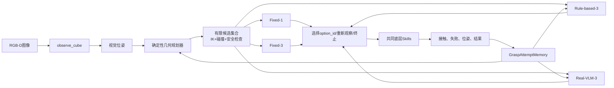

# Failure-Aware Skill Planning v6 中文报告

## 1. 结论摘要

v6 增加了同重试预算的 `Fixed-3` 基线、抓取尝试记忆、物体局部几何重复检测、确定性候选生成和真实 OpenAI-compatible 视觉语言模型接口。

100个配对随机场景的已完成结果是：

| 策略 | 最大尝试 | 首次成功 | 最终成功 | 恢复收益 | 异常推动 | 平均尝试 |
|---|---:|---:|---:|---:|---:|---:|
| Fixed-1 | 1 | 52% | 52% | 0个百分点 | 0% | 1.00 |
| Fixed-3 | 3 | 52% | **95%** | +43个百分点 | 1% | 1.65 |
| Failure-aware Rule-based-3 | 3 | 52% | 93% | +41个百分点 | 1% | 1.64 |
| Real-VLM-3（Gemini） | 3 | 52% | **91%** | +39个百分点 | 1% | 1.59 |

Real-VLM-3 使用已配置的 `gemini-3.5-flash-lite` 完成了真实在线评测，共发起58次可追踪调用。没有用 Mock 或 Rule-based 回退替代模型决策；唯一一次网络 TLS EOF 直接记为该 episode 失败。由于未配置该模型的输入/输出单价，报告中的成本为 `null`，而不是错误地记作0。

最重要的归因结果：

- 纯重复预算收益：`Fixed-3 − Fixed-1 = +43` 个百分点；
- 自适应规则净收益：`Rule-3 − Fixed-3 = -2` 个百分点；
- 真实VLM净收益：`Real-VLM-3 − Fixed-3 = -4` 个百分点；
- Rule-3 相对 Fixed-1 的总收益为 +41 个百分点，但不能称为智能规划收益；
- 在当前100个种子上，大部分收益来自“允许重新释放、重新观察并再次尝试”，而不是避免重复几何；
- Fixed-3 反而比 Failure-aware Rule-3 高2个百分点，说明“重复尝试”有时能受益于重新释放后的物理扰动和新观测，不能机械地禁止重复。

## 2. v5失败轨迹审计

审计数据：`results/skill_agent_ablation_failures.jsonl`。

### 种子25

- 第1次：candidate 1，tangent +10 mm，closure −15 mm，无双侧接触；
- 第2次：世界视觉位姿完全相同，candidate 1，tangent仍为 +10 mm，仅closure改为 +15 mm；
- 第2次发生左侧提前接触；
- 第3次物体已明显移动，切换candidate 0后仍提前接触。

### 种子56

- 前两次视觉世界位姿完全相同；
- 两次均使用candidate 1和tangent +10 mm；
- closure从−15 mm改到+15 mm；
- 两次都无法建立稳定双侧接触；
- 第3次物体已移动，candidate 0触发位移超限。

### 种子72

- 前两次世界位姿完全相同；
- 连续使用candidate 1和tangent +10 mm；
- 第1次无双侧接触，第2次出现右侧提前接触；
- 第3次物体已移动，candidate 0仍发生右侧提前接触。

### 种子83

- 前两次视觉位置相差不到1微米，可视为同一世界场景；
- 连续使用candidate 1和tangent +10 mm；
- 第1次完全无接触；
- 第2次右侧接触率约0.508、左侧约0；
- 第3次切到candidate 0后仍未建立双侧接触。

审计结论：参数文本不同并不等于几何尝试真正不同；反之，物体被推动后即使参数文本相同，也不能直接视为相同世界几何。因此 v6 同时比较物体局部抓取位姿和当前世界场景。

## 3. v6 架构



所有策略继续共用：

- `observe_cube`
- `plan_grasp`
- `approach_grasp`
- `verify_pose`
- `establish_grasp`
- `test_lift`
- `retreat`

Planner不能输出关节目标、执行器值、直接位姿、接触成功标记或安全开关。

## 4. GraspAttemptMemory

每次尝试保存：

- 尝试序号；
- candidate编号和面对；
- tangent/closure受限参数；
- 视觉估计的魔方世界位置和yaw；
- 夹爪目标世界位置和yaw；
- 夹爪在物体局部坐标系中的位置和相对yaw；
- 左右接触率；
- 左右法向力；
- 最大滑移；
- 失败代码或成功状态；
- 是否与历史尝试几何重复；
- 来源图像哈希。

### 几何重复判定

只有同时满足以下条件才判定重复：

- 面对相同；
- 物体局部夹爪位置距离不超过4 mm；
- 物体局部yaw差不超过3度；
- 当前视觉世界位置差不超过15 mm；
- 当前世界yaw差不超过5度。

该定义具备两个重要性质：

1. 同一个世界场景中，仅把参数重新序列化不能逃避重复检测；
2. 物体已经明显移动或旋转后，相同参数会被视为新的真实几何，而不是错误地标记为重复。

v6 的 Fixed-3 平均每个episode有0.30次重复尝试，28%的episode至少出现一次真实重复几何。Rule-based-3为0，说明记忆确实阻止了相似几何重复。

## 5. 确定性几何规划器

几何规划器从视觉位姿和两个对向面基础候选生成有限选项集合。每个选项包含：

- 唯一 `option_id`；
- candidate编号和面对；
- 手腕yaw；
- 受限tangent/closure偏移；
- 世界目标位姿；
- 物体局部目标位姿；
- IK可行性；
- 碰撞可行性；
- 安全检查状态；
- 几何评分；
- 重复几何标记；
- 拒绝原因。

Rule-based和Real-VLM只能：

- 从这个集合选择一个 `option_id`；
- 请求重新观察；
- 终止。

Real-VLM选择未知或未通过安全检查的option时，系统会拒绝执行。

## 6. 四种策略与公平性

### Fixed-1

- 一次尝试；
- 固定使用candidate 1、tangent +10 mm、closure −15 mm。

### Fixed-3

- 最多三次；
- 每次使用完全相同的固定参数；
- 故意忽略Attempt Memory；
- 用于测量纯重试和重新观察的收益。

### Failure-aware Rule-based-3

- 第一次强制使用与Fixed相同的公共基线；
- 失败后从安全、未重复候选中选择；
- 结合左右接触不平衡调整选择；
- 没有未重复安全候选时可以请求重新观察或终止。

### Real-VLM-3

- 第一次同样强制使用公共基线；
- 只有恢复阶段调用真实视觉语言模型；
- 模型接收当前RGB图像、视觉位姿、候选、接触数据、失败历史和Attempt Memory；
- 模型只能输出 `select`、`reobserve` 或 `abort`；
- 所有响应必须通过Pydantic和候选安全检查；
- 未配置真实端点时不运行，绝不使用Mock补数。

## 7. 100种子配对结果

### 指标

| 指标 | 定义 |
|---|---|
| 首次成功率 | 公共第一次尝试完成正式抬升的比例 |
| 最终成功率 | 最大尝试预算内完成正式抬升的比例 |
| 恢复收益 | 最终成功率减首次成功率 |
| 异常推动率 | 任一Approach中物体位移超过12 mm的episode比例 |
| 重复尝试 | 被世界+物体局部几何判为重复的尝试数量 |
| 推理耗时 | Planner/VLM决策墙钟时间，不含仿真和视觉渲染 |
| 成本 | 真实VLM返回token usage后按配置单价计算 |

### 已完成四组

| 策略 | 首次 | 最终 | 恢复收益 | 平均尝试 | 异常推动 | 平均重复尝试 | 有重复episode |
|---|---:|---:|---:|---:|---:|---:|---:|
| Fixed-1 | 52% | 52% | 0 | 1.00 | 0% | 0 | 0% |
| Fixed-3 | 52% | **95%** | +43pp | 1.65 | 1% | 0.30 | 28% |
| Rule-based-3 | 52% | 93% | +41pp | 1.64 | 1% | 0 | 0% |
| Real-VLM-3 | 52% | 91% | +39pp | 1.59 | 1% | 0 | 0% |

Rule-based平均决策耗时为每episode约0.0044 ms，无VLM调用和费用。

Real-VLM平均每episode调用0.58次、决策耗时1514.66 ms；按真实调用计算，58次请求的平均延迟为2611.49 ms，中位数2136.47 ms，P95为4246.71 ms。累计输入309,307 tokens、输出6,444 tokens。因模型单价未配置，不能给出可信美元成本。

### 收益归因

```text
纯重试收益    = Fixed-3 - Fixed-1 = +43pp
自适应净收益  = Rule-3  - Fixed-3 =  -2pp
Rule总收益    = Rule-3  - Fixed-1 = +41pp
真实VLM净收益 = Real-3  - Fixed-3 =  -4pp
真实VLM总收益 = Real-3  - Fixed-1 = +39pp
```

因此，当前数据不支持“90%左右成功率来自智能规划”的说法。相反，Fixed-3达到95%，说明重新释放、重新观察和物理状态扰动本身贡献了主要收益。

Failure-aware策略消除了几何重复，但并未提高总体成功率。这意味着重复不是必然错误：如果第一次失败来自瞬态接触或释放后的物理状态变化，使用相同局部抓取几何仍可能成功。正确策略应把重复作为风险特征，而不是硬性禁止。

## 8. 重点种子的v6结果

| 种子 | Fixed-3 | Rule-based-3 | 主要观察 |
|---|---|---|---|
| 25 | 失败 | 失败 | Rule避免重复，但第3次双侧保持仍不稳定 |
| 56 | 第3次成功 | 失败 | Fixed第2次是真实重复，第3次物体移动后相同局部参数成功 |
| 72 | 第3次成功 | 失败 | 重复/物理扰动比当前自适应候选更有效 |
| 83 | 失败 | 失败 | 连续无法建立双侧接触；Fixed第2次被正确标记为重复 |

这四个种子直接说明：候选多样性本身不保证恢复成功，几何评分仍需结合接近余量、接触可达性和失败后的物体实际变化继续改进。

## 9. 真实VLM接口与调用追踪

实现类：`OpenAICompatibleFailureAwareVLM`。

支持云端OpenAI-compatible视觉接口或vLLM托管模型。每次真实调用记录：

- provider类型；
- 模型名；
- 端点主机名，不记录API key；
- prompt SHA-256；
- 图像 SHA-256；
- 延迟；
- 输入/输出token；
- 按配置单价计算的美元成本；
- 原始文本响应；
- 解析后的受限决策；
- 错误信息。

调用轨迹写入：

```text
results/failure_aware_v6_ablation_vlm_calls.jsonl
```

本轮文件包含58条真实调用记录：57条成功解析为受限的 `select`，1条为TLS EOF网络错误。选择分布为：`c1_t+0_c+0` 47次、`c0_t+0_c+0` 9次、`c1_t+20_c+0` 1次。模型常见的 `select_option`、`execute`、`execute_option` 和 `execute_grasp` 仅作为 `select` 的语义别名；它们仍必须引用确定性规划器生成且通过IK、碰撞和安全检查的 `option_id`。

Real-VLM-3失败种子为25、31、56、60、66、72、82、83、92。其中种子66由真实网络错误造成，其余终止原因包括接近碰撞、无可行抓取、位姿验证失败及双侧接触未建立。

### 配置并运行完整四组

```bash
export CUBERELAY_VLM_ENDPOINT="https://your-openai-compatible-endpoint/v1"
export CUBERELAY_VLM_MODEL="your-real-vision-model"
export CUBERELAY_VLM_API_KEY="..."

MUJOCO_GL=glfw python scripts/evaluate_failure_aware_v6.py \
  --episodes 100 \
  --seed 0 \
  --output results/failure_aware_v6_ablation.json
```

脚本会自动读取仓库根目录的 `.env`（不会覆盖已有进程环境变量）。若要统计美元成本，应通过 `CUBERELAY_VLM_INPUT_COST_PER_MILLION` 和 `CUBERELAY_VLM_OUTPUT_COST_PER_MILLION` 提供经过确认的单价；未配置时成本保持 `null`。报告中的Real-VLM状态必须为`evaluated`，且调用轨迹非空，才能把第四组称为Real-VLM-3。

## 10. 运行命令与产物

### 无真实VLM的三组配对评测

```bash
MUJOCO_GL=glfw python scripts/evaluate_failure_aware_v6.py \
  --episodes 100 --seed 0 \
  --output results/failure_aware_v6_ablation.json
```

### 回放种子25的Rule失败

```bash
MUJOCO_GL=glfw python scripts/failure_aware_v6_demo.py \
  --planner rule3 --seed 25 \
  --output runs/failure_aware_v6_rule_failure_seed25
```

### 回放种子56的Fixed-3重复恢复成功

```bash
MUJOCO_GL=glfw python scripts/failure_aware_v6_demo.py \
  --planner fixed3 --seed 56 \
  --output runs/failure_aware_v6_fixed3_recovery_seed56
```

### 主要文件

- `results/failure_aware_v6_ablation.json`
- `results/failure_aware_v6_ablation_failures.jsonl`
- `results/failure_aware_v6_ablation_vlm_calls.jsonl`
- `runs/failure_aware_v6_rule_failure_seed25/episode.mp4`
- `runs/failure_aware_v6_rule_failure_seed25/episode.json`
- `runs/failure_aware_v6_fixed3_recovery_seed56/episode.mp4`
- `runs/failure_aware_v6_fixed3_recovery_seed56/episode.json`

## 11. 当前限制与下一步

1. Real-VLM-3已运行，但模型单价未配置，因此只能报告token，不能报告可信美元成本；
2. 当前确定性几何评分在100种子上比固定重复策略低2个百分点，Real-VLM比Fixed-3低4个百分点；
3. 应将重复尝试从“硬惩罚”改为结合失败类型、物体移动和接触瞬态的概率风险；
4. 对无接触失败，可以允许一次受控重复；对稳定单侧接触，应优先改变闭合轴或面对；
5. 候选评分需要加入预测接近余量、魔方角点包络和夹爪遮挡后的视觉不确定性；
6. 目前没有证据表明VLM选择优于Fixed-3或Rule-based-3；下一轮应针对9个失败种子改进候选质量，而不是扩大VLM的低层控制权限。
