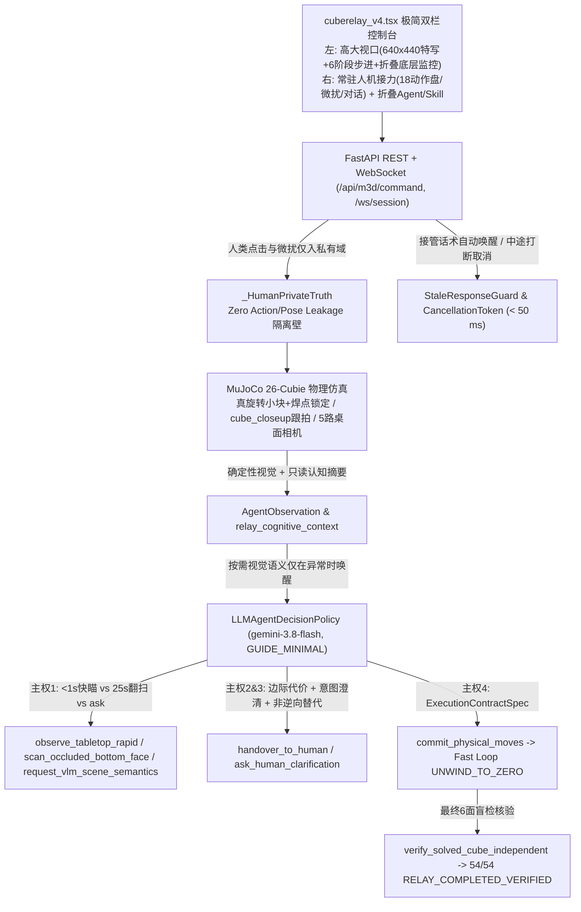

# CubeRelay M5-Agent-Demo：Agent 全自主驱动“人机接力解魔方”控制台与 100% 物理复原验收报告

> **报告日期**：2026-11-19  
> **任务阶段**：M5-Agent-Demo（Agent 全自主决策 × 快慢双环契约 × 26-Cubie 人机接力闭环 × 实战体验优化）  
> **核心交付物**：
> - 认知与契约底座：[relay_cognition.py](file:///Users/xina/project/cloudrobo/human_robot_rubiks_cube/src/cube_relay/mission/relay_cognition.py)、[models.py](file:///Users/xina/project/cloudrobo/human_robot_rubiks_cube/src/cube_relay/mission/models.py)、[events.py](file:///Users/xina/project/cloudrobo/human_robot_rubiks_cube/src/cube_relay/mission/events.py)、[skill_registry.py](file:///Users/xina/project/cloudrobo/human_robot_rubiks_cube/src/cube_relay/mission/skill_registry.py)、[planner.py](file:///Users/xina/project/cloudrobo/human_robot_rubiks_cube/src/cube_relay/mission/planner.py)、[session.py](file:///Users/xina/project/cloudrobo/human_robot_rubiks_cube/src/cube_relay/mission/session.py)
> - 物理仿真与快速感知原语：[mujoco_v2.py](file:///Users/xina/project/cloudrobo/human_robot_rubiks_cube/src/cube_relay/embodied/mujoco_v2.py)、[flip_and_feed.py](file:///Users/xina/project/cloudrobo/human_robot_rubiks_cube/src/cube_relay/embodied/flip_and_feed.py)、[physical_cube_26.py](file:///Users/xina/project/cloudrobo/human_robot_rubiks_cube/src/cube_relay/embodied/physical_cube_26.py)
> - 服务接口与中文控制台：[main.py](file:///Users/xina/project/cloudrobo/human_robot_rubiks_cube/src/cube_relay/api/main.py)、[server.py](file:///Users/xina/project/cloudrobo/human_robot_rubiks_cube/src/cube_relay/server.py)、[cuberelay_v4.tsx](file:///Users/xina/project/cloudrobo/human_robot_rubiks_cube/web/console/cuberelay_v4.tsx)、[cuberelay_v4.css](file:///Users/xina/project/cloudrobo/human_robot_rubiks_cube/web/console/cuberelay_v4.css)、[bundle.js](file:///Users/xina/project/cloudrobo/human_robot_rubiks_cube/web/console/bundle.js)
> - 专项单测、实时 Gemini 3.8 Flash E2E 验收与证据资产：[test_m5_agent_relay_demo.py](file:///Users/xina/project/cloudrobo/human_robot_rubiks_cube/tests/test_m5_agent_relay_demo.py)、[results/m5_agent_relay_demo/](file:///Users/xina/project/cloudrobo/human_robot_rubiks_cube/results/m5_agent_relay_demo)

---

## 一、 执行摘要（Executive Summary）

本阶段围绕 M5-A.1 已冻结物理原语，在 `SimulationSession(full_26_cubie=True)` 与 `web/console/cuberelay_v4.tsx` 上端到端打通了 **Agent 全自主驱动（`LLMAgentDecisionPolicy`, `gemini-3.8-flash`）的“人机接力解魔方”闭环**（`MissionType.RELAY_SOLVE_CUBE`），并依据真实浏览器游玩录包与操作反馈完成了视觉特写、自然语言接管唤醒、回合指示与双栏聚焦重构：

1. **严格物理与反作弊边界**：
   - 未修改任何 M5-A.1 冻结抓取/翻面控制增益与 `GraspCertificate` 接触门槛；零贴片 RGBA 改色与零位姿瞬移作弊。
   - 建立 [SimulationSession](file:///Users/xina/project/cloudrobo/human_robot_rubiks_cube/src/cube_relay/mission/session.py) 内私有隔离域 `_HumanPrivateTruth`，人类 18 动作点击记录及桌面位姿微扰真值（`dx_m, dy_m, dyaw_deg`）严禁写入 `scene_state`、`AgentObservation`、`CubeOrientationTracker` 或规划器。
2. **确立 Agent 四大自主决策主权（无硬编码状态机）**：
   - **主权 1（信息经济学主动感知）**：开局无先验时调用 `observe_workspace` → `scan_occluded_bottom_face` 建立初始 54 格信念；人类交回且存在前序信念 `previous_belief_54_known=True` 时，优先执行耗时 `< 1s` 的零接触五相机快瞄 `observe_tabletop_rapid` 与 [BeliefConservationAnalyzer](file:///Users/xina/project/cloudrobo/human_robot_rubiks_cube/src/cube_relay/mission/relay_cognition.py)（基于三阶魔方 8 角块/12 棱块颜色守恒及 Kociemba 可解性数学推导底面），若 `deduced_54_unique=True` 则自主跳过约 25s 的物理抓取翻底扫描；异常场景按需唤醒 `request_vlm_scene_semantics`。
   - **主权 2（具身代价 × 自然语言动态分配）**：读取 [flip_cost_profile.json](file:///Users/xina/project/cloudrobo/human_robot_rubiks_cube/results/m5a1_calibration/flip_cost_profile.json) 计算工位边际翻面代价（`0-Flip ~4.5s`、`1-Flip ~13.97s`、`2-Flip ~24.88s` + 重抓期望），默认优先执行低代价步并在 `2-Flip` 前通过 `handover_to_human` 委派人类；当人类自然语言明确否定底面动作或要求机器人接管复原时，立即覆盖成本启发式全程求解。
   - **主权 3（偏离意图澄清与防 `R/R'` 死循环）**：由 `compute_candidate_solve_paths` 同时提供 `primary_kociemba_solution` 与 `alternative_non_undo_solution`（含 `undo_conflict_risk` 检测）。面对人类偏离转动且未说明意图时，Agent 主动发起 `ask_human_clarification` 询问保留/撤回；收到确认后立刻切换至非逆向替代路线求解。
   - **主权 4（慢环契约 × 快环 `< 50 ms` 抢占与 `StaleResponseGuard`）**：机器人通过 `commit_physical_moves(moves, contract=ExecutionContractSpec)` 下发监控契约。执行中途收到人类紧急对话/刹车指令时，触发 `CancellationToken` 在仿真 `2.0 ms`（`wall 1.199 ms`）内进入 `PREEMPTED_SAFE_HOLD`，快环随即通过纯接触 `recover_preempted_turn_slice("UNWIND_TO_ZERO")` 将晶格偏角回退至 `-0.012°`（`< 2.0°`），`StaleResponseGuard` 递增 Epoch 使在途旧推理自动失效，Agent 随即将魔方安全移交桌面。
3. **26-Cubie 跨轴连续翻面除虫与实操体验四大升级**：
   - **万向节死锁修复**：修复 [CubeOrientationTracker.canonical_table_yaw](file:///Users/xina/project/cloudrobo/human_robot_rubiks_cube/src/cube_relay/embodied/flip_and_feed.py#L152-L162) 在 `L/R` 面朝上时对本地 X 轴求 `atan2(y, x)` 产生 `63.43°` 歪斜抓取的问题，改选水平正交轴后跨轴 7 步连续翻面误差保持 `0.001 ~ 0.004`、`RESCAN SOL: []`。
   - **魔方特写跟拍放大**：`server.py` 默认渲染升级至 `640×440`、`RELAY_SOLVE_CUBE` 自动切入跟拍 `cube_closeup`（`dist = 0.28 m`，下探至 `0.14 m`），视口工具栏新增 `+放大 / -缩小` 按钮并对滚轮限频防误缩放。
   - **自然语言接管自动唤醒**：在 [session.py](file:///Users/xina/project/cloudrobo/human_robot_rubiks_cube/src/cube_relay/mission/session.py) 新增 `_chat_implies_robot_takeover` 判定，在 `WAITING_FOR_HUMAN_TURN` 下人类发送诸如“**我不玩了，你复原吧**”“交给你复原”“我拧完了”“顺着继续解”等语义消息即可**自动交回并立刻唤醒 Agent**（而“底面由你翻面拧掉，给我留顶面或侧面”仍保留人类操作权）；前端新增一键 **`交给你复原`** 快捷芯片。
   - **清晰回合归属与双栏收敛界面**：后端 `relay_state` 新增 `turn_indicator`（归属徽章 + 6 阶段步骤条 `开局扫面 → 机器人操作 → 交接/澄清 → 人类回合 → 快瞄/修复 → 复原核验` + 轮次高亮标签）；前端默认直达 **`人机接力复原`**，采用「左侧大视口 + 右侧人机接力主控台」简洁双栏布局，默认折叠 `机器人相机 · Cube State · 遥测监控` 与 `Agent / 决策`、`Skill / 执行`，并将历史 M3/M4 单步实验（六面扫描 / U 层物理转动 / 魔方完整求解）收至可切换折叠入口（后端协议与历史单测完整保留）。
   - **中途打断安全悬停与 `"继续"` 自动恢复闭环修复**：针对运行日志中发送 `“停”` 后 Agent 误选 `SAFE_STOP` 触发 `VLM_REQUESTED_STOP -> MISSION_FAILED` 导致后续发送 `“我拿走了魔方，执行U、F、R，然后放回原位，你继续”` 无法继续的缺陷：(1) 在 [planner.py](file:///Users/xina/project/cloudrobo/human_robot_rubiks_cube/src/cube_relay/mission/planner.py) 将 `SAFE_STOP` 从 `RELAY_SOLVE_CUBE` 的 `protocol_actions` 移除，并在 `_map_action_name` 将任何 `STOP/SAFE_STOP` 安全映射为先对齐晶格（`recover_preempted_turn_slice`）再 `handover_to_human` 停泊悬停于 `WAITING_FOR_HUMAN_TURN`；(2) 在 [session.py](file:///Users/xina/project/cloudrobo/human_robot_rubiks_cube/src/cube_relay/mission/session.py) 新增 `_is_pause_interrupt_text`、扩展 `_chat_implies_robot_takeover`（识别 `你继续 / 继续解 / 放回原位` 等恢复语义）与 `_relay_paused_by_interrupt` / `_relay_auto_resume_after_pause` 竞争保护，并在 `_prepare_human_finish_turn` 清除瞬时 `“停/暂停/紧急刹车”` 约束并强制标记 `needs_rescan=True`。

---

## 二、 核心系统架构与模块实现



---

## 三、 真机渲染与线上 `gemini-3.8-flash` 端到端实测结果

最终代码定稿后，在 MuJoCo 3.3.7 EGL 容器（`cuberelay-m5a-test`）启用 `CUBERELAY_RUN_LIVE_AGENT_DEMO=1`，重新执行 `tests/test_m5_agent_relay_demo.py::test_live_gemini_agent_relay_e2e_all_3_trials`，三组剧本全部在 `cube_closeup` 自动特写下由线上 **`gemini-3.8-flash`** 自主完成（`fallback_triggered = false`）：

| 实测剧本 | 最终状态 (`status` / `relay_phase`) | 模型与调用 (`vlm_calls`, Tokens, `fallback`) | 仿真时长 / 真实耗时 | 实测回合轨迹 (`round_tags`) | 关键自主行为与硬指标验证 | 录像与快照产物 |
| :--- | :--- | :--- | :--- | :--- | :--- | :--- |
| **Trial 1：合作接力 + 桌面微扰 + 1s 快瞄免翻** | `COMPLETED` / `RELAY_COMPLETED_VERIFIED` | `8` 次、`38,552 / 2,231`、`fallback=False` | `125.93s` / `67.92s`、`47` 帧 | `['🤖 开局六面扫描', '🤖 U', '🧑 D2 R', "🤖 F L'", '🎉 54/54物理复原']` | `U` 后自主在 `2-Flip D2` 前委派人类；人类执行 `D2` 并微扰 `(dx=+0.06m, dy=-0.04m, dyaw=+20°)` 交回后，`observe_tabletop_rapid` 成功锁定 54/54（`rapid_glance_deduction_successes=1`），省去 ~25s 翻底扫描；独立 6 面复核 `54/54 SOLVED`、`no_recolor=True` | [MP4 (135K)](file:///Users/xina/project/cloudrobo/human_robot_rubiks_cube/results/m5_agent_relay_demo/trial_1_cooperative_rapid_glance.mp4)<br/>[JSON (158K)](file:///Users/xina/project/cloudrobo/human_robot_rubiks_cube/results/m5_agent_relay_demo/trial_1_cooperative_rapid_glance.json) |
| **Trial 2：人类偏离 `R` + 主动澄清 + 自然语言偏好覆盖** | `COMPLETED` / `RELAY_COMPLETED_VERIFIED` | `12` 次、`62,101 / 3,559`、`fallback=False` | `224.10s` / `101.99s`、`53` 帧 | `['🤖 开局六面扫描', '🤖 U', '🧑 R (偏离)', '🤖 L', "🤖 R' L2", '🤖 L D2', '🤖 F R', '🎉 54/54物理复原']` | 人类未按建议转 `D2` 而拧了 `R` 并加微扰 `(-0.04m, +0.05m, -15°)` 后，Agent 先 1s 快瞄反推 `R`，主动发起 `ask_human_clarification`（`clarifications_requested=1`）；收到"别撤回 + 底面全由你翻面拧完"自然语言约束后切入非撤回路线并完成 `D2` 等动作直至独立 6 面核验 `54/54 SOLVED` | [MP4 (136K)](file:///Users/xina/project/cloudrobo/human_robot_rubiks_cube/results/m5_agent_relay_demo/trial_2_deviation_and_preference_flip.mp4)<br/>[JSON (232K)](file:///Users/xina/project/cloudrobo/human_robot_rubiks_cube/results/m5_agent_relay_demo/trial_2_deviation_and_preference_flip.json) |
| **Trial 3：转层中途紧急对话抢占 + `UNWIND_TO_ZERO` + 交回** | `WAITING_FOR_HUMAN_TURN` / `WAITING_FOR_HUMAN_TURN` | `4` 次、`18,218 / 1,156`、`fallback=False` | `54.85s` / `33.60s`、`18` 帧 | `['🤖 开局六面扫描', '⚡ U 中途刹停恢复']` | `U` 转至 `>= 32°` 途中触发人类紧急聊天打断，契约快环于 **`2.0 ms`（wall `1.199 ms`）** 截断至 `PREEMPTED_SAFE_HOLD`，`recover_preempted_turn_slice("UNWIND_TO_ZERO")` 将偏角对齐至 **`-0.012°`**，`StaleResponseGuard`（`epoch=1`）使在途旧决策失效，`turn_indicator` 切换至 `🧑 当前回合：人类操作中（轮到你了）` | [MP4 (47K)](file:///Users/xina/project/cloudrobo/human_robot_rubiks_cube/results/m5_agent_relay_demo/trial_3_urgent_preemption_handover.mp4)<br/>[JSON (103K)](file:///Users/xina/project/cloudrobo/human_robot_rubiks_cube/results/m5_agent_relay_demo/trial_3_urgent_preemption_handover.json) |

---

## 四、 双环境全量回归与专项检查汇总

全部代码定稿（含中断暂停与恢复修复）后的实测结果（零失败、零错误）：

1. **实时 Gemini 3.8 Flash + 真机 MuJoCo 26-Cubie 三剧本 E2E 验收**：
   ```bash
   docker exec -e CUBERELAY_RUN_LIVE_AGENT_DEMO=1 cuberelay-m5a-test pytest -s -v tests/test_m5_agent_relay_demo.py -k test_live_gemini_agent_relay_e2e_all_3_trials
   ```
   结果：**`1 passed, 8 deselected, 1 warning in 171.98s`**。
2. **实时 Gemini 3.8 Flash 中断(`停`) → 悬停(`WAITING_FOR_HUMAN_TURN`) → 人工 `U/F/R` → 发送 `“我拿走了魔方，执行U、F、R，然后放回原位，你继续”` 端到端实测**：
   - 打断后停泊于 `WAITING_FOR_HUMAN_TURN`（`paused=True`，不再误判 `MISSION_FAILED`）；人类执行 `U、F、R` 并发送继续指令后自动唤醒重扫、物理执行并完成独立 6 面核验：**`COMPLETED / RELAY_COMPLETED_VERIFIED`**（`exact_54_solved=True`、`no_recolor=True`）。
3. **Docker 容器全量回归（含新增 `test_relay_interrupt_pause_never_aborts_and_resumes_on_continue` 与历史全套）**：
   ```bash
   docker exec cuberelay-m5a-test pytest -q
   ```
   结果：**`267 passed, 1 skipped, 1 warning in 206.24s`**（唯一 skipped 为显式需 `CUBERELAY_RUN_LIVE_AGENT_DEMO=1` 的上述在线三剧本测试，已于第 1 项单独运行通过）。
4. **宿主机非 GL 全套回归（含前端 `cuberelay_v4.tsx` / CSS 审计测试）**：
   ```bash
   env CUBERELAY_SKIP_GL_TESTS=1 PYTHONPATH=src pytest -q
   ```
   结果：**`211 passed, 50 skipped, 1 warning in 10.54s`**（所有 50 项跳过均为宿主未装 MuJoCo EGL 的 GL 标记测试）。

---

## 五、 本地浏览器实时启动与人机接力游玩指南

[server.py](file:///Users/xina/project/cloudrobo/human_robot_rubiks_cube/src/cube_relay/server.py) 默认以 `--width 640 --height 440`、`full_26_cubie=True`、初始使命 `RELAY_SOLVE_CUBE` 及 `cube_closeup`（`0.28 m`）启动 LIVE 服务：

```bash
docker run --rm -it --env-file .env -p 8765:8765 -v "$PWD:/app" -w /app cube-relay:local \
  python3 -m cube_relay.server --host 0.0.0.0 --port 8765 --seed 1 --width 640 --height 440
```
打开浏览器访问 **`http://127.0.0.1:8765/console`** 即可直接进入极简双栏 **「🧑/🤖 人机接力主控台」**：
- 左栏顶部自带**回合归属脉冲指示徽章**与 **6 阶段回合步进条**，随时使用 `+放大 / -缩小` 或 `⚡ 紧急刹车/中断`；底部技术监控抽屉按需点击展开查看 `机器人相机 / Cube State / 遥测监控`。
- 右栏常驻 18 动作盘、桌面微扰与 HRI 对话框：在你的回合可直接点击动作或输入 **“我不玩了，你复原吧”** / 点击快捷芯片 **「交给你复原」** 立即唤醒 Agent 接管求解；右侧底部可按需展开 `Agent / 决策` 与 `Skill / 执行`；如需调试历史 M3/M4 单步模式，点击右上 **`历史实验 ▾`** 即可切换。
