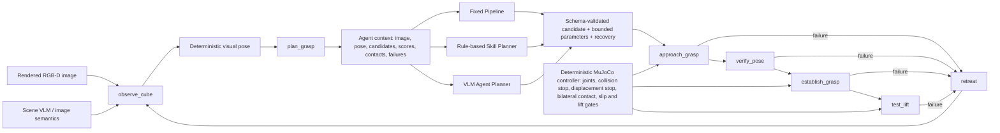

# Skill-Based Embodied Agent grasp architecture

## Architecture and safety boundary



The Planner cannot output actuator or joint targets. Its complete action schema is:

- next Skill (`approach_grasp` at the candidate-selection decision point) and
  recovery Skill (`retreat`);
- candidate index: 0 or 1;
- tangent offset: −20 to +20 mm;
- closure-axis offset: −15 to +15 mm;
- recovery: retry or abort;
- a diagnostic reason.

Pydantic rejects extra fields, including attempted joint targets, and rejects
out-of-range parameters. The Planner cannot modify MuJoCo state, mark contact as
successful, call lift before grasp verification, or disable a safety check.

## Standard Skills

Every Skill has a frozen Pydantic input/output contract, preconditions, timeout,
success criteria, failure code and `SkillLog`. Each log records sequence number,
simulation time, wall duration, timeout, evaluated preconditions, serialized input
and serialized output.

| Skill | Preconditions | Timeout | Deterministic success criterion |
|---|---|---:|---|
| `observe_cube` | camera available | 3 s | VLM says visible and RGB-D localizer returns a pose |
| `plan_grasp` | cube observed | 1 s | at least one IK- and collision-feasible opposing-face candidate |
| `approach_grasp` | plan and selected candidate exist | 4 s | guarded motion completes with no early pad/palm collision and ≤12 mm cube displacement |
| `verify_pose` | approach completed | 3 s | a new RGB-D observation localizes the cube within the occlusion-aware position gate |
| `establish_grasp` | visual pose verified | 4 s | symmetric closure produces sustained bilateral solved contact and ≥0.35 N per side |
| `test_lift` | stable bilateral contact | 5 s | trial lift and full lift retain contact, stay within the requested ≤30 mm slip bound and clear the table |
| `retreat` | backend ready | 3 s | fingers open and pad contact is released before re-observation |

Important failure codes include `APPROACH_UNEXPECTED_COLLISION`,
`APPROACH_OBJECT_DISPLACED`, `POSE_VERIFICATION_FAILED`,
`BILATERAL_CONTACT_NOT_ESTABLISHED`, `BILATERAL_CONTACT_UNSTABLE`,
`BILATERAL_CONTACT_REQUIRED`, `TRIAL_LIFT_UNSTABLE` and
`FULL_LIFT_UNSTABLE`.

`approach_grasp` checks collision and cube displacement every 2 ms MuJoCo step,
not merely at telemetry sampling intervals. It holds the measured stage pose as
soon as a guard trips. `test_lift` independently checks its bilateral-contact
precondition, so a Planner cannot skip `establish_grasp`.

## Contact-geometry correction

The original maximum inner jaw opening was 216 mm. With a 120 mm square cube,
random yaw and P95 visual position error around 26 mm, a cube corner could contact
one descending pad before closure. A paired Approach-only scan confirmed that the
old default candidate was especially vulnerable.

The physical gripper now has a 256 mm maximum inner opening while retaining the
same 75 mm inward joint travel. Approach uses a smooth cubic position trajectory.
The shared static geometry selected from 30 paired seeds is candidate 1, +10 mm
tangent offset and −15 mm closure-axis offset. This is used by all three Planners;
it is not a VLM-only advantage.

## Planners

- **Fixed Pipeline:** one attempt using the shared static geometry.
- **Rule-based Skill Planner:** up to three attempts. It re-observes after retreat,
  tries the opposite bounded closure offset, then the other opposing-face candidate
  with a contact-balance correction.
- **VLM Agent Planner:** the same Skills and Pydantic decision boundary. The checked-in
  paired evaluator uses `ConstrainedHeuristicVLMProvider`, explicitly a **Mock**, so
  results are deterministic and do not depend on an external service. A hosted VLM
  can replace that provider, but receives only RGB, VLM semantics, visual pose,
  candidate scores, left/right contact summaries and failure history. It gains no
  simulator-state or safety bypass.

## Paired 3×100 result

All modes use seeds 0–99, the same MuJoCo model, perception, controller, Skills and
physical parameters.

| Planner | First-attempt success | Final success | Mean attempts | Abnormal push | Planner calls | VLM calls | Mean decision time |
|---|---:|---:|---:|---:|---:|---:|---:|
| Fixed Pipeline | 52% | 52% | 1.00 | **0%** | 1.00 | 0 | 0 ms |
| Rule-based | 52% | **90%** | 1.61 | 2% | 1.59 | 0 | 0.0007 ms |
| VLM Agent, offline Mock | 52% | **90%** | 1.61 | 2% | 1.59 | 1.59 | 0.0189 ms |

The earlier 59% number measured full rotation using a monolithic flow that allowed
early pad contact to continue. The new 52% first-attempt metric measures safe full
lift and stops on any pre-closure collision, so it is not an exact before/after
rotation comparison. The useful findings are:

- the common geometry fix and guards reduce the fixed pipeline's measured abnormal
  push rate to 0%;
- bounded release/re-observe/retry raises final full-lift success to 90%;
- two of 100 adaptive episodes still exceed the 12 mm displacement threshold and
  are stopped, so contact geometry is not solved;
- the offline VLM Mock adds decision cost but no success advantage over rules.

The ten final rule-based failures include unresolved bilateral-contact acquisition,
approach collision/displacement, visual verification/localization and one infeasible
post-recovery geometry. Failures are retained with complete Skill and contact logs.

## Run and replay

```bash
MUJOCO_GL=glfw python scripts/evaluate_skill_agent.py \
  --episodes 100 --seed 0 --output results/skill_agent_ablation.json

MUJOCO_GL=glfw python scripts/skill_agent_demo.py \
  --planner rule --seed 1 --output runs/skill_agent_success_seed1

MUJOCO_GL=glfw python scripts/skill_agent_demo.py \
  --planner rule --seed 56 --output runs/skill_agent_failure_seed56

MUJOCO_GL=glfw pytest -q
```

Artifacts:

- `results/skill_agent_ablation.json`: summaries and all episode metrics;
- `results/skill_agent_ablation_failures.jsonl`: full Skill logs and contact traces;
- `runs/skill_agent_success_seed1/`: stopped first approach followed by successful recovery;
- `runs/skill_agent_failure_seed56/`: bilateral failures followed by guarded displacement stop.

## Fidelity labels and remaining work

- **Physical MuJoCo:** free cube, parallel pads, friction, solved contacts, joint
  motion, safety stop, trial lift and full lift.
- **Deterministic:** RGB-D pose estimation, candidate generation, all low-level
  control and success gates.
- **Approximate:** Cartesian gantry, box collision geometry and occlusion-aware
  post-approach visual tolerance.
- **Mock:** the offline VLM decision provider and the existing virtual-human
  handover weld. Neither is counted as learned VLM performance or physical robot
  grasping.

The next physical improvement should add low-speed visual servoing before the final
vertical descent and compliant lateral centering after a clean release. A real VLM
comparison is meaningful only after connecting a hosted provider and reporting its
model, prompt, token usage, latency and failure consistency separately.
