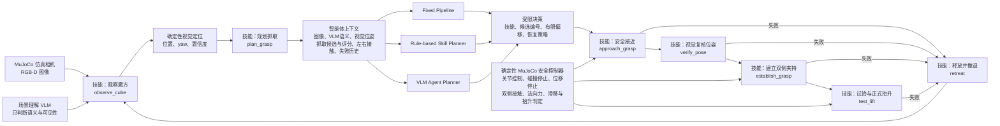

# CubeRelay 基于技能的具身智能体架构

## 1. 目标与结论

本次升级将 CubeRelay 的抓取流程从单体函数改造成“高层智能体决策 + 标准化技能 + 确定性安全控制器”的分层架构。

核心原则是：

- LLM/VLM 不直接输出关节位置、力矩或 MuJoCo 控制量；
- 智能体只能选择技能、预先生成的抓取候选、受限偏移参数和恢复策略；
- 碰撞停止、位移限制、双侧接触确认、试抬和滑移判定全部由确定性控制器执行；
- Planner 无法修改仿真状态、伪造成功结果或绕过安全前置条件；
- Fixed Pipeline、Rule-based Planner 和 VLM Agent Planner 共用完全相同的底层技能和物理模型。

在种子 0–99 的 3×100 配对实验中：

- Fixed Pipeline 首次及最终成功率为 52%；
- Rule-based Skill Planner 最终成功率为 90%；
- VLM Agent Planner（离线 Mock provider）最终成功率为 90%；
- Fixed Pipeline 异常推动率为 0%，两个自适应 Planner 为 2%。

VLM Planner 当前使用明确标记的离线 Mock provider，因此其 90% 结果不能解释成真实 VLM 能力提升。它的意义是验证 VLM 接口和安全边界，而不是证明某个视觉大模型优于规则策略。

## 2. 中文架构图



### 分层职责

| 层级 | 负责内容 | 明确禁止 |
|---|---|---|
| Planner/Agent | 选择下一个技能、抓取候选、受限偏移和恢复策略 | 输出关节动作、修改仿真状态、跳过安全检查 |
| Skill 层 | 校验输入、检查前置条件、调用确定性后端、生成结构化日志 | 自行宣告未经验证的成功 |
| 确定性控制器 | 轨迹执行、碰撞监控、位移监控、接触和滑移判定 | 接受 Planner 提供的任意低层控制量 |
| MuJoCo | 刚体、关节、摩擦、接触力、重力和物理积分 | 使用 weld 或直接位姿赋值伪造机器人抓取 |

## 3. Planner 可用的决策接口

Planner 的决策使用 Pydantic 严格校验。完整可控字段只有：

| 字段 | 类型与范围 | 含义 |
|---|---|---|
| `skill` | 固定为 `approach_grasp` | 当前候选选择节点允许执行的技能 |
| `candidate_index` | `0` 或 `1` | 从确定性模块生成的两个对向面候选中选择一个 |
| `tangent_offset_m` | `[-0.020, 0.020]` | 沿夹爪切向的有限位置修正 |
| `closure_offset_m` | `[-0.015, 0.015]` | 沿夹爪闭合方向的有限位置修正 |
| `recovery` | `retry` 或 `abort` | 失败后重试或终止 |
| `recovery_skill` | 固定为 `retreat` | 失败恢复必须先释放并撤退 |
| `reason` | 字符串 | 可观测的决策原因 |

以下输出会被拒绝：

- 任意 `robot_x_ctrl`、`joint_targets`、力矩或执行器值；
- 未定义字段；
- 越界偏移；
- 未注册技能；
- 试图关闭碰撞、位移、双侧接触或滑移检查的参数。

## 4. 标准化 Skill 接口

所有 Skill 都具有：

- Pydantic 输入模型；
- Pydantic 输出模型；
- 明确前置条件；
- 固定超时；
- 确定性成功判据；
- 标准失败代码；
- 可序列化的 `SkillLog`。

每条 `SkillLog` 包含：

- 执行序号；
- Skill 名称；
- 仿真开始时间；
- 墙钟耗时；
- 超时阈值；
- 每项前置条件及判断结果；
- 完整输入；
- 完整输出和失败代码。

### 4.1 `observe_cube`

输入：

```json
{
  "camera_name": "overhead"
}
```

输出内容：

- 场景语义 `SceneSemantics`；
- 视觉估计的魔方三维中心、yaw、置信度和像素数量；
- 图像尺寸；
- 图像 SHA-256，用于轨迹关联而不是代替原始图像。

前置条件：相机可用。

超时：3 秒。

成功判据：VLM/场景理解认为魔方可见，并且确定性 RGB-D 定位器成功输出位姿。

失败代码：

- `CUBE_NOT_VISIBLE`
- `LOCALIZATION_FAILED`

### 4.2 `plan_grasp`

输入：视觉检测结果 `CubeDetection`。

输出：两个对向面抓取候选，每个候选包含：

- 手腕 yaw；
- 抓取面对；
- IK 是否可行；
- 碰撞几何是否可行；
- 接触几何评分；
- 运动代价；
- 拒绝原因。

前置条件：已完成有效视觉观察。

超时：1 秒。

成功判据：至少存在一个 IK 和碰撞几何均可行的候选。

失败代码：`NO_FEASIBLE_GRASP`。

### 4.3 `approach_grasp`

输入：

- 视觉检测结果；
- 候选编号；
- 受限切向偏移；
- 受限闭合轴偏移。

前置条件：已经完成抓取规划，候选存在且可行。

超时：4 秒。

确定性安全保证：

- 接近轨迹采用平滑三次曲线，避免控制目标突变；
- 每个 2 ms MuJoCo 仿真步检查一次；
- 闭合前出现任一夹爪垫或掌部非预期接触，立即保持当前测量关节位置并停止；
- 魔方相对接近开始位置移动超过 12 mm，立即停止；
- Planner 无法修改或关闭上述阈值。

输出：

- 是否成功；
- 失败代码；
- 魔方位移；
- 非预期接触数量；
- 左右接触数量。

失败代码：

- `CANDIDATE_INFEASIBLE`
- `APPROACH_UNEXPECTED_COLLISION`
- `APPROACH_OBJECT_DISPLACED`

### 4.4 `verify_pose`

接近完成后重新采集 RGB-D 图像，不使用 MuJoCo 内部位姿冒充视觉结果。

输入：接近前的视觉位姿。

输出：

- 接近后的视觉位姿；
- 视觉位置差；
- 视觉 yaw 差。

前置条件：`approach_grasp` 成功。

超时：3 秒。

成功判据：在夹爪部分遮挡条件下仍能重新定位，并通过位置一致性门限。yaw 仍记录到日志，但由于正方形对称性和遮挡，不作为唯一否决条件。独立的物理位移安全限制仍为更严格的 12 mm。

失败代码：`POSE_VERIFICATION_FAILED`。

### 4.5 `establish_grasp`

输入：最小法向力要求，合法范围为 0.35–2.0 N，不能低于系统安全下限。

前置条件：接近后的视觉位姿已经通过验证。

超时：4 秒。

执行过程：

1. 左右夹爪使用相同目标进行对称慢速闭合；
2. 读取 MuJoCo 求解后的左右接触和法向力；
3. 要求双侧接触连续维持规定时间；
4. 进入稳定保持阶段；
5. 保持阶段继续检查接触比例、法向力和滑移。

输出：

- 左右接触率；
- 左右平均法向力；
- 最大相对滑移；
- 成功或标准失败代码。

失败代码：

- `BILATERAL_CONTACT_NOT_ESTABLISHED`
- `BILATERAL_CONTACT_UNSTABLE`

### 4.6 `test_lift`

输入：最大允许滑移，合法范围 5–30 mm，不能放宽到系统上限以上。

前置条件：`establish_grasp` 已确认稳定双侧接触。

超时：5 秒。

执行过程：

1. 小幅试抬；
2. 检查左右接触保持率、滑移和实际离桌高度；
3. 试抬成功后才进入正式抬升；
4. 正式抬升再次检查双侧接触、滑移和高度。

即使 Planner 尝试直接调用本 Skill，也会因为前置条件失败而返回 `BILATERAL_CONTACT_REQUIRED`。

失败代码：

- `BILATERAL_CONTACT_REQUIRED`
- `TRIAL_LIFT_UNSTABLE`
- `FULL_LIFT_UNSTABLE`

### 4.7 `retreat`

输入：恢复原因。

前置条件：后端可用。

超时：3 秒。

执行过程：先对称张开夹爪，再垂直撤离，确认夹爪垫已经释放魔方。不会直接修改魔方位姿。

失败代码：`RELEASE_FAILED`。

## 5. Agent 可观测上下文

Agent/Planner 能获取：

- 当前 RGB 图像；
- VLM 场景语义、可见性和语义置信度；
- 确定性视觉模块估计的三维位置、yaw 和视觉置信度；
- 两个抓取候选及其几何评分、IK、碰撞可行性和运动代价；
- 上一次左右接触率和接触不平衡；
- 标准失败代码历史；
- 当前尝试次数；
- 图像尺寸和哈希。

Agent/Planner 不能获取或控制：

- 用于识别的 MuJoCo 魔方真实位姿；
- 魔方内部逻辑状态作为视觉识别结果；
- 任意关节和执行器目标；
- 接触成功标记；
- 碰撞、位移、法向力、滑移或试抬安全开关。

仿真真实位姿只允许在离线评测中用于计算误差和统计指标，不进入正常 Planner 决策接口。

## 6. 三种对照 Planner

### 6.1 Fixed Pipeline

- 最多尝试一次；
- 使用所有模式共享的固定抓取候选和偏移；
- 失败后执行安全撤退并终止；
- 不产生 VLM 决策成本。

### 6.2 Rule-based Skill Planner

- 最多尝试三次；
- 每次失败后必须执行 `retreat → observe_cube → plan_grasp`；
- 第二次使用相反方向的受限闭合轴修正；
- 第三次尝试另一组对向面候选，并根据左右接触历史做有限修正；
- 所有低层动作仍由相同确定性 Skill 完成。

### 6.3 VLM Agent Planner

- 使用与 Rule-based Planner 完全相同的 Skill、安全门限和最大尝试次数；
- provider 接收图像、场景语义、视觉位姿、候选评分、左右接触摘要和失败历史；
- provider 输出仍必须通过 `PlannerDecision` Pydantic 模型；
- 当前评测 provider 为 `ConstrainedHeuristicVLMProvider`，属于离线 Mock；
- Mock 复用规则恢复逻辑，因此结果与 Rule-based Planner 相同是预期现象。

未来接入云端 VLM 或 vLLM 时，只替换 provider，不修改 Skill 和安全控制器。真实模型评测必须额外记录模型名称、提示词版本、token、延迟、超时和不可解析输出率。

## 7. 接近阶段物理问题与修复

### 7.1 原因

旧夹爪最大内宽为 216 mm。魔方边长为 120 mm，但随机 yaw 后的角点包络更大，加上全视觉位置 P95 误差约 26 mm，垂直接近时魔方角点可能在闭合前先接触单侧夹爪。

这正是原始失败中“单侧接触推动物体”的主要物理来源，不能由 VLM 决策掩盖。

### 7.2 修复

- 最大夹爪内宽从 216 mm 增加到 256 mm；
- 保留 75 mm 单侧闭合行程，闭合后仍可接触 120 mm 魔方；
- Approach 由目标跳变改成平滑三次轨迹；
- 安全检查从稀疏日志采样改为每个仿真步执行；
- 使用30个相同随机种子的 Approach-only 扫描选择共同几何参数；
- 最终固定参数为候选 1、切向 +10 mm、闭合轴 −15 mm。

该参数同时用于 Fixed、Rule-based 和 VLM 三种模式。

## 8. 3×100 配对评测

### 8.1 实验条件

- 随机种子：0–99；
- 每组100场景，共300个抓取实验；
- 相同 MuJoCo 模型、质量、摩擦、求解器和控制参数；
- 相同视觉定位器；
- 相同七个 Skill；
- 相同安全阈值；
- 仅 Planner 策略不同。

### 8.2 指标定义

| 指标 | 定义 |
|---|---|
| 首次抓取成功率 | 第一次尝试完成稳定双侧夹持、试抬和正式抬升的比例 |
| 最终成功率 | 在 Planner 允许的最大恢复次数内最终完成正式抬升的比例 |
| 平均尝试次数 | 每个 episode 实际执行的抓取尝试数量 |
| 异常推动率 | 任一 Approach 尝试中魔方位移超过 12 mm 的 episode 比例 |
| Planner 调用数 | 每个 episode 的平均高层决策次数 |
| VLM 调用数 | 每个 episode 的平均 VLM Planner provider 调用次数 |
| 决策耗时 | 仅高层决策函数的墙钟耗时，不包含物理仿真和视觉渲染 |

### 8.3 最终结果

| Planner | 首次成功率 | 最终成功率 | 平均尝试次数 | 异常推动率 | 平均 Planner 调用 | 平均 VLM 调用 | 平均决策耗时 |
|---|---:|---:|---:|---:|---:|---:|---:|
| Fixed Pipeline | 52% | 52% | 1.00 | **0%** | 1.00 | 0 | 0 ms |
| Rule-based Skill Planner | 52% | **90%** | 1.61 | 2% | 1.59 | 0 | 0.0007 ms |
| VLM Agent Planner，离线 Mock | 52% | **90%** | 1.61 | 2% | 1.59 | 1.59 | 0.0189 ms |

### 8.4 结果解释

旧的 59% 指标来自单体抓取流程，统计的是完整90度旋转成功率，并允许闭合前的夹爪接触继续执行。新架构的 52% 首次成功率统计的是启用严格 Approach 安全停止后的完整抬升成功率。因此两者不是完全相同的指标，不能简单解释为成功率从59%下降到52%。

新结果说明：

1. Fixed Pipeline 的异常推动率降至0%，说明接近阶段安全停止有效；
2. 首次尝试依然只有52%，说明单次视觉定位和静态几何仍不够可靠；
3. 释放、撤退、重新观察和有限重试将最终成功率提高到90%；
4. 自适应模式仍有2%的 episode 超过12 mm 位移限制并被停止，基础物理问题尚未完全解决；
5. VLM Mock 没有带来额外成功率，只增加了决策调用和耗时；
6. 当前证据支持继续优化接近和柔顺对中，而不是增加夹持力或扩大 VLM 权限。

### 8.5 最终失败

Rule-based 和 VLM Mock 各有10个最终失败 episode，涉及：

- 多次无法建立稳定双侧接触；
- Approach 非预期碰撞；
- Approach 位移超限；
- 接近后视觉复核失败；
- 恢复后魔方不可见或定位失败；
- 恢复后没有可行抓取候选。

所有失败均保存在 JSONL 中，包含完整 Skill 日志和接触级轨迹。

## 9. 自动化测试

新增测试覆盖：

- Planner 输出包含关节目标时被拒绝；
- Planner 偏移越界时被拒绝；
- 没有稳定双侧接触时不能调用 `test_lift`；
- Skill 日志包含前置条件和结构化输入输出；
- Approach 非预期接触会停止；
- 安全撤退后必须重新观察；
- 恢复成功路径严格经过 `observe → plan → approach → verify → establish → lift`；
- 54个贴片仍保持零密度；
- robot grasp 仍不存在 weld；
- 新夹爪几何具有256 mm最大内宽。

最终测试结果：

```text
115 passed in 9.37s
```

## 10. 运行命令

### 10.1 运行3×100配对评测

```bash
MUJOCO_GL=glfw python scripts/evaluate_skill_agent.py \
  --episodes 100 \
  --seed 0 \
  --output results/skill_agent_ablation.json
```

### 10.2 运行规则 Planner 成功恢复案例

```bash
MUJOCO_GL=glfw python scripts/skill_agent_demo.py \
  --planner rule \
  --seed 1 \
  --output runs/skill_agent_success_seed1
```

该案例第一次 Approach 因非预期接触被安全停止，第二次重新观察后成功。

### 10.3 运行失败诊断案例

```bash
MUJOCO_GL=glfw python scripts/skill_agent_demo.py \
  --planner rule \
  --seed 56 \
  --output runs/skill_agent_failure_seed56
```

该案例两次未能建立双侧接触，第三次触发 Approach 位移超限并停止。

### 10.4 运行完整测试

```bash
MUJOCO_GL=glfw pytest -q
```

## 11. 结果与回放文件

- `results/skill_agent_ablation.json`：300个 episode 的摘要和逐场指标；
- `results/skill_agent_ablation_failures.jsonl`：所有最终失败的完整 Skill 与接触轨迹；
- `runs/skill_agent_success_seed1/episode.mp4`：安全停止后恢复成功的视频；
- `runs/skill_agent_success_seed1/episode.json`：对应 Skill 日志和接触轨迹；
- `runs/skill_agent_failure_seed56/episode.mp4`：位移保护失败案例视频；
- `runs/skill_agent_failure_seed56/episode.json`：对应失败诊断数据。

## 12. 真实性与近似边界

### 真实物理仿真

- 自由刚体魔方；
- 平行夹爪实体碰撞；
- MuJoCo 摩擦与求解接触力；
- 重力；
- 关节运动；
- 双侧接触；
- 试抬、正式抬升和滑移；
- Approach 碰撞和位移安全停止。

机器人抓取未使用 weld、mocap 或运行时直接修改魔方位姿。

### 确定性实现

- RGB-D 几何定位；
- 抓取候选生成；
- IK与保守碰撞几何检查；
- 轨迹执行；
- 接触、法向力、滑移、抬升判定；
- Skill 前置条件和失败代码。

### 简化模型

- 机械臂是笛卡尔龙门结构，而非完整工业机械臂；
- 碰撞体主要为盒体；
- IK 是解析关节范围检查，不是通用数值 IK；
- 接近后视觉复核使用针对夹爪遮挡的容差；
- 魔方转面仍是受约束机构近似，不是26个独立 cubie 的完整接触模型。

### Mock

- 当前离线 VLM Agent provider；
- 已明确标记的虚拟人类交接 weld。

这两项都不能当成真实 VLM 能力或真实机器人抓取成果。

## 13. 剩余问题与建议

当前优先级最高的工作不是继续优化 yaw，也不是给 VLM 更大的低层控制权限，而是：

1. 在最终垂直接近前增加低速视觉伺服；
2. 使用多相机或遮挡感知位姿融合改善接近后验证；
3. 在完全释放后执行接触感知的横向重新对中；
4. 引入受安全约束的柔顺/阻抗控制，降低单步接触冲量；
5. 对剩余10个失败场景做配对 Contact-Level Debugging；
6. 接入真实云端 VLM 或 vLLM 后，单独统计 token、延迟、不可解析输出、策略稳定性和相对规则 Planner 的净收益。

只有当真实 VLM 在相同 Skill、安全约束、随机种子和物理参数下优于规则 Planner，才能说明 VLM 对恢复决策有实际价值。
